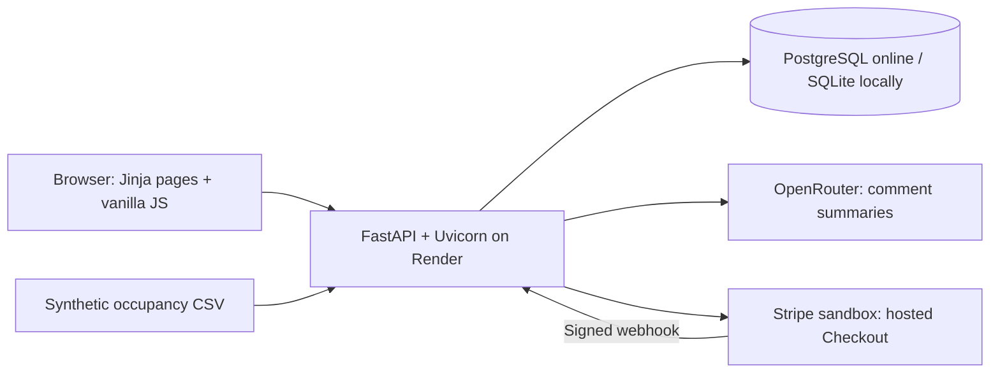

# Library Status · HackUCD 2026

### Know before you go. Find a seat, skip the wasted trip.

A student-powered live view of UCD's James Joyce Library. Check how busy it is, share what you see, read an AI digest of recent comments, and earn points for helping other students plan their next study session.

**[Visit the live website →](https://hack-ucd-library.onrender.com/)** · [Leaderboard](https://hack-ucd-library.onrender.com/leaderboard) · [Premium](https://hack-ucd-library.onrender.com/premium)

Built for **HackUCD 2026**, under the theme **Everyday Frustrations**: walking across campus only to discover that the library is full.

## Try it in a minute

1. **[Open Library Status](https://hack-ucd-library.onrender.com/)** and check the current estimate and confidence.
2. Use the **demo login** with a name and a demo email address. Email ownership is not verified, so use an invented identity.
3. Report **Not full**, **~80% full**, or **Full**, or leave a short comment about seats, noise, sockets or Wi-Fi.
4. Earn **5 points per accepted report** and **2 per accepted comment**. Check your position on the leaderboard.
5. Explore Premium's one-hour forecast and simulated alert history. Checkout runs in **Stripe sandbox**; no real payment is taken.

The hosted app may need a little time to wake up after being idle.

## What we built

| Feature | What students get |
|---|---|
| Live occupancy | A shared estimate that prioritises fresh reports, with confidence and update time |
| One-tap reporting | Three clear status buttons, a cooldown countdown, and immediate points |
| Community comments | A scrollable feed of short updates from other students |
| AI bullet summaries | Up to five useful observations drawn only from comments in the past hour |
| Live leaderboard | The top ten contributors, shared ranks for ties, and your own position even outside the top ten |
| Premium forecast | An explainable estimate of how busy the library may be in one hour |
| One-time demo purchase | EUR 1.99 sandbox Checkout that upgrades the paying account to permanent Premium |
| Alert history | A persistent record of getting-busy and space-opening triggers on the Premium page |
| Private feedback | Student feedback saved to the database, with a separate password-protected team inbox |
| Responsive design | A warm library-inspired palette, library photography, animated report controls and a bookshelf leaderboard |

The leaderboard highlights the **top-three prize: one month of Premium free**. Awarding that prize is a team action for now; automatic grants and monthly score resets are not implemented.

## Technical highlights

### Recent reports can replace an outdated consensus

Occupancy is a weighted estimate, rather than a count of every report ever submitted:

- Each eligible person has **one current vote**, using their latest report. Flagged accounts and accounts with zero trust are excluded.
- A report's weight **halves every three minutes**, multiplied by the account's trust score.
- A group of **at least three different people reporting within five minutes** establishes a fresh cutoff. The calculation keeps at most the **five newest independent reports** from that cutoff onward.
- Earlier reports stay in the database but stop influencing the estimate. Reconstructing the latest qualifying group prevents discarded votes from returning just because newer votes age.
- Without a qualifying group, reports can provide a sparse fallback for up to **45 minutes**.
- A fresh group can change the state immediately; sparse reporting uses hysteresis to avoid flickering around Full.

For example, **30 older ~80% reports followed by three fresh Full reports now produces Full** in the API regression test.

The three report values are `not_full = 0`, `busy = 0.8`, and `full = 1`. A weighted score above `0.9` means Full; otherwise `0.5` or above means ~80% full. With sparse updates, a previous Full state is retained until the score drops below `0.8`. Confidence is medium with three or four selected reports fresh within five minutes, high with five, and low otherwise. The ~80% label is an estimate category, not a measured seat count.

### AI summaries with bounded inputs and graceful fallback

The backend uses the **OpenAI Python SDK pointed at OpenRouter**. It sends up to 50 visible comments from the past hour, without attaching account names or emails. At least three comments are needed before making an AI call.

Responses must pass strict validation: **one to five bullet points**, at most 180 characters each, plus validated internal theme and moderation fields. Comment text is treated as untrusted input. Model moderation can hide identified spam or abuse, but is fallible.

Database caching avoids a call on every page refresh. Regeneration considers new comments, cache age, model changes and expired source comments. A 15-second provider timeout, model fallback list and one-minute failure cooldown protect the page from upstream failures. A still-relevant cached summary can be returned as stale. A process lock prevents duplicate generation within one app worker.

### An explainable one-hour forecast

Premium combines a typical weekday/time pattern with the current live deviation:

```text
forecast in 1 hour = typical occupancy in 1 hour
                  + 0.5 × (live occupancy now − typical occupancy now)
```

The profile uses 15-minute slots and weights recent weeks more heavily. No recent live reports means the typical pattern is used alone. The response includes confidence, a range and an explanation, and handles assumed closed hours in the Europe/Dublin timezone.

**The included five weeks of history are synthetic**, generated by a reproducible script. A backtest compares the method with typical-pattern and same-as-now baselines, including noisy live readings. This demonstrates the method, not proven real-world accuracy. The app does not currently train automatically on newly submitted reports; replacing the history with real observations is future work. Assumed hours are Mon–Fri 08:00–22:00 and Sat–Sun 10:00–18:00, not an authoritative library timetable.

### Payments verified on the server

Stripe Checkout uses **payment mode**, not a subscription. The configured sandbox Price must be an active one-time **EUR 1.99** price. A verified purchase grants permanent Premium to that account.

Both signed webhooks and authenticated checkout-return confirmation use the same idempotent transaction. Before granting access, the backend checks the session's owner, paid status, sandbox mode, purpose and actual line-item price. A unique session ID prevents duplicate payment records. Live keys and live events are rejected.

### Alert triggers with a persistent audit trail

The backend records two transitions:

| Transition | Recorded alert |
|---|---|
| Not full → ~80% full | Getting busy |
| Full → ~80% full | Space opening up |

Each event stores its timestamp and the count of active Premium accounts that would receive it. The Premium page displays the shared history, with pagination and no recipient identities. A singleton database row serialises observations to prevent duplicate events from concurrent requests.

**No email, push or other notification is actually sent.** Checks run around accepted reports and during status/history requests; there is no independent scheduler. Initial, missing or stale observations establish a baseline rather than inventing earlier events.

### Consistent scoring and private feedback

Points are awarded **in the same transaction** as a successful contribution. Reports have a ten-minute cooldown; comments have a one-minute cooldown, a 280-character limit, and same-user duplicate rejection for two hours. Failed submissions award no points. Competition ranking handles ties as `1, 1, 3`.

Feedback is stored separately, with a 2,000-character limit and a one-minute cooldown. The `/feedback` page serves an inbox shell; reading submissions requires a separate team password and signed session. Access does not depend on the unverified demo email address.

## Architecture and stack



| Layer | Implementation |
|---|---|
| Backend | Python, FastAPI routers, Uvicorn, Pydantic validation |
| Persistence | SQLAlchemy Core; PostgreSQL via psycopg online, SQLite locally |
| Frontend | Jinja2, vanilla JavaScript and CSS; no frontend build step |
| Live updates | Browser polling: status/ranks every 10 seconds, comments/summary every 30 seconds, forecast every minute while visible |
| Sessions | Starlette signed cookies; HTTPS-only cookies in production |
| AI | OpenRouter through the OpenAI SDK; server-side credentials and persisted caches |
| Payments | Stripe sandbox SDK, Checkout, signed webhook and return confirmation |
| Deployment | Render web service with an external PostgreSQL database (Neon in our setup) |
| Tests | pytest, FastAPI TestClient, controlled app clock, provider mocks and regression cases |

Production startup checks require a strong session secret, an HTTPS public URL, normal clock speed and disabled replay endpoints. Request handling includes origin checks for browser mutations, a 64 KB body limit, parameterised database operations and plain-language JSON errors. The frontend inserts user text with `textContent`.

The database stores accounts, reports, comments, status snapshots, points, payment records, AI caches, feedback and simulated alert events. Tables are created additively on startup. Online persistence comes from PostgreSQL rather than the hosted app's local files.

## Run locally

Clone the repository using an account with access, then create a Python virtual environment:

```bash
git clone https://github.com/Conor-Collins1/Hack-UCD-1.git
cd Hack-UCD-1
python -m venv .venv
```

Activate it:

```powershell
# Windows PowerShell
.\.venv\Scripts\Activate.ps1
Copy-Item .env.example .env
```

```bash
# macOS / Linux
source .venv/bin/activate
cp .env.example .env
```

Install and start:

```bash
pip install -r requirements.txt
python -m library.cli init-db
uvicorn app.main:app --reload
```

Open **[localhost:8000](http://127.0.0.1:8000/)**. SQLite works without a database key. AI, Checkout and the private feedback inbox need their respective optional settings below.

### Environment settings

Use `.env` locally and Render's environment settings online. **Never commit real credentials or a database connection string.** `.env.example` contains placeholders only.

| Setting | Purpose |
|---|---|
| `APP_ENV` | `development` locally; `production` on Render |
| `SESSION_SECRET` | A random secret of at least 32 characters; signs sessions |
| `PUBLIC_URL` | Exact app origin: `http://127.0.0.1:8000` locally, `https://hack-ucd-library.onrender.com` for our deployment |
| `DATABASE_URL` | Leave blank for local SQLite; use the hosted PostgreSQL connection string online |
| `OPENROUTER_API_KEY` | Enables AI summaries; server-side only |
| `OPENROUTER_MODEL` | Model selection; defaults to `openrouter/free` |
| `STRIPE_SECRET_KEY` | Sandbox secret key beginning `sk_test_` |
| `STRIPE_PRICE_ID` | The sandbox one-time EUR 1.99 **Price ID** (`price_…`), not the Product ID |
| `STRIPE_WEBHOOK_SECRET` | Signing secret for the configured Stripe webhook endpoint |
| `FEEDBACK_ADMIN_PASSWORD` | A random password of at least 32 characters for the team's feedback inbox |
| `DEMO_MODE` / `DEMO_SPEED` | Keep `0` / `1` online; synthetic replay settings for local development only |

For a local webhook listener, use the Stripe CLI in another terminal and put its signing secret in your local environment:

```bash
stripe listen --forward-to 127.0.0.1:8000/webhooks/stripe
```

### Deploy on Render

Connect this GitHub repository as a Python Web Service, using branch `main`:

```text
Build:        pip install -r requirements.txt
Start:        uvicorn app.main:app --host 0.0.0.0 --port $PORT --workers 1
Health check: /health
```

Set the production environment values above, including an external PostgreSQL `DATABASE_URL`. Use one worker for the AI generation lock. Configure Stripe's sandbox webhook to reach `/webhooks/stripe` and listen for `checkout.session.completed`; checkout-return confirmation also verifies purchases directly with Stripe.

For current hosting allowances, consult [Render's free-service documentation](https://render.com/docs/free) and [Neon's plans](https://neon.com/pricing). AI availability and limits are separate from app hosting.

## Tests and developer tools

```bash
python -m pytest -q
python scripts/generate_history.py --backtest
```

**161 tests passed at the time of this README update.** Coverage includes occupancy recency and cutoffs, cooldowns, transactional scoring, tied ranks, API validation, sessions, AI output validation and fallback, sandbox payment verification and idempotency, feedback access, alert transitions, page behaviour and forecast calculations.

For a synthetic local replay, set `DEMO_MODE=1` and `DEMO_SPEED=60`, start the local app, then run `python scripts/replay.py` in another terminal. Use a disposable database. Production refuses to start with replay mode enabled.

| Path | Responsibility |
|---|---|
| `app/main.py` | App startup, middleware, router wiring and health check |
| `library/db.py`, `auth.py`, `clock.py` | Schema, demo sessions and controllable time |
| `library/status.py`, `trust.py`, `core_routes.py` | Occupancy, scoring, ranks and contribution APIs |
| `library/ai.py`, `integration_routes.py` | Summary generation, caching and integration endpoints |
| `library/payments.py`, `notify.py` | Verified sandbox upgrades and simulated alert events |
| `library/forecast.py`, `forecast_routes.py` | Premium forecast and access control |
| `templates/`, `static/` | Server-rendered pages, responsive styling and browser behaviour |
| `scripts/`, `data/` | Replay tooling and synthetic forecast history |
| `tests/` | Automated checks and regression coverage |
| `CLAUDE.md`, `plan/` | Shared development contract and original team plans |

FastAPI's interactive API reference is available at `/docs`; the detailed shared contracts are in [CLAUDE.md](CLAUDE.md). The original [team plans](plan/) include superseded tasks; this README describes the current implementation.

## Demo scope and next steps

This is a working hackathon prototype. Demo login does not verify identity. The live database can contain submitted names, emails, comments and feedback; it is **not exclusively synthetic**. Comments are sent to OpenRouter for summaries, so avoid including personal information in them.

Trust weights and flagged-account exclusions are supported, but **automatic report judgement and bad-actor flagging are still TODOs**. Other next steps are verified authentication, real historical occupancy data, actual notification delivery, scheduled alert checks, and automatic leaderboard prize grants.

**[Try Library Status →](https://hack-ucd-library.onrender.com/)**
